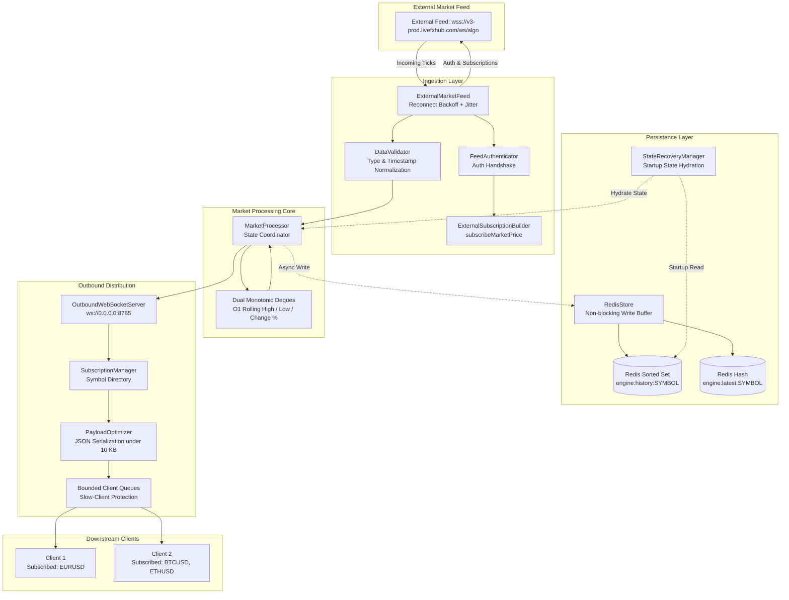

# Real-Time Pricing Engine

Production-grade, low-latency market data processing engine engineered in Python with `asyncio`, `websockets`, and `redis`. Built for fault-tolerant ingestion, independent rolling 24-hour statistical computations, durable state persistence, and efficient symbol-based WebSocket distribution.

[](https://www.python.org/downloads/)
[]()
[]()
[]()
[-blue.svg)]()
[](https://vercel.com/new/clone?repository-url=https%3A%2F%2Fgithub.com%2FShubhraAR-Hebbar%2FTask)

---

## 1. Project Overview

The **Real-Time Pricing Engine** solves the critical challenges of processing high-frequency financial feeds:
- Ingests streaming market data from external algo WebSocket feeds (`wss://v3-prod.livefxhub.com/ws/algo`).
- Enforces a verified authentication handshake before requesting subscriptions.
- **Strictly ignores incoming `low_24h`, `high_24h`, and `change_24h` fields**, computing all rolling statistics independently from raw observations.
- Uses **dual monotonic deques** to achieve amortized $O(1)$ time complexity for rolling High and Low calculations without re-scanning historical ticks.
- Persists state in Redis (AOF + RDB) with an asynchronous write buffer to survive server restarts without losing 24-hour statistical baselines.
- Serves an outbound WebSocket distribution server with fine-grained symbol subscriptions, bounded queues, and slow-client isolation.
- Delivers measured payloads of **~164 bytes per tick** and **~752 bytes per snapshot**, far below the 10 KB requirement.

---

## 2. Architecture



Detailed architectural diagrams and sequence flows are documented in [docs/architecture.md](file:///c:/Users/Shubhra/OneDrive/Desktop/task/docs/architecture.md).

---

## 3. Technologies Used

| Technology | Purpose | Version |
| :--- | :--- | :--- |
| **Python** | Core backend language | 3.13+ |
| **asyncio** | High-performance asynchronous non-blocking event loop | Standard Library |
| **websockets** | Ingestion client and outbound distribution server | >= 13.1 |
| **Redis** | Fast state storage, Sorted Sets (`ZSET`), and persistence | >= 7.2 |
| **orjson** | Ultra-fast C-accelerated JSON parsing & serialization | >= 3.10 |
| **pydantic-settings** | Type-safe environment variable and secret configuration | >= 2.7 |
| **pytest & pytest-asyncio** | Automated asynchronous unit and integration testing | >= 8.3 |
| **fakeredis** | In-memory Redis simulation for deterministic CI unit tests | >= 2.26 |
| **Docker & Docker Compose** | Multi-stage containerization and orchestrations | 3.8 |

---

## 4. Project Structure

```
realtime-pricing-engine/
├── app/
│   ├── __init__.py
│   ├── main.py                  # Application entry point and orchestrator
│   ├── config.py                # Environment configuration with pydantic-settings
│   ├── logging_config.py        # Structured logging with secret masking filter
│   ├── ingestion/
│   │   ├── __init__.py
│   │   ├── market_feed.py       # External WS client with backoff & jitter
│   │   ├── authentication.py    # Strict auth handshake & response evaluator
│   │   └── subscriptions.py     # Provider subscribeMarketPrice builder
│   ├── processing/
│   │   ├── __init__.py
│   │   ├── market_processor.py  # Coordinates validation and per-symbol windows
│   │   ├── rolling_window.py    # Dual monotonic deques for O(1) 24h calculations
│   │   └── validation.py        # Inbound payload validator (ignores provider 24h stats)
│   ├── storage/
│   │   ├── __init__.py
│   │   ├── redis_store.py       # Async Redis client with queue buffering & failover
│   │   └── recovery.py          # State hydration replaying 24h history on boot
│   ├── distribution/
│   │   ├── __init__.py
│   │   ├── websocket_server.py  # Outbound client WS server
│   │   ├── subscriptions.py     # Client symbol directory and lookup
│   │   └── payload_optimizer.py # Precision rounding, compact JSON (< 10 KB)
│   └── monitoring/
│       ├── __init__.py
│       └── metrics.py           # Latency percentiles (P50/P95/P99), throughput & telemetry
├── tests/
│   ├── test_market_processor.py # Validates ignoring provider stats, mid-price
│   ├── test_rolling_window.py   # Monotonic deques, out-of-order ticks, expirations
│   ├── test_recovery.py         # Redis crash recovery, corrupted data tolerance
│   ├── test_payload_optimizer.py# Outbound payload byte constraints (< 10 KB)
│   ├── test_websocket_server.py # Multiple clients, symbol filtering, slow-client isolation
│   └── test_fault_tolerance.py  # Auth failures, reconnect backoff, socket drops
├── scripts/
│   ├── benchmark.py             # Measures throughput, latency percentiles, payload sizes
│   ├── mock_external_feed.py    # Mock livefxhub provider for offline demo & testing
│   └── demo_client.py           # Demonstration subscriber displaying live ticks
├── docs/
│   └── architecture.md          # Architectural blueprints and mathematical proofs
├── .env.example                 # Configuration template with placeholder credentials
├── .gitignore                   # Excludes .env, secrets, logs, and build artifacts
├── requirements.txt             # Pinned Python package dependencies
├── Dockerfile                   # Multi-stage unprivileged production image
├── docker-compose.yml           # Compose stack with persistent Redis & engine
├── pytest.ini                   # Test discovery and configuration
└── README.md
```

---

## 5. Prerequisites

- Python 3.10+ (Python 3.13 recommended)
- Git
- Docker and Docker Compose (optional, for containerized deployment)
- Redis server (optional; engine automatically falls back to in-memory mode if Redis is disabled or offline)

---

## 6. Installation Instructions

1. **Clone the repository:**
   ```bash
   git clone <repo_url>
   cd realtime-pricing-engine
   ```

2. **Create and activate a virtual environment:**
   ```bash
   python -m venv .venv
   # Windows:
   .\.venv\Scripts\activate
   # Linux/macOS:
   source .venv/bin/activate
   ```

3. **Install dependencies:**
   ```bash
   pip install --upgrade pip
   pip install -r requirements.txt
   ```

---

## 7. Environment Configuration

Create a `.env` file by copying `.env.example`:
```bash
cp .env.example .env
```

Configure your parameters in `.env`:
```env
# External Provider Settings
EXTERNAL_WS_URL=wss://v3-prod.livefxhub.com/ws/algo
API_KEY=YOUR_PUBLIC_KEY
API_SECRET=YOUR_SECRET_KEY
SUBSCRIBE_SYMBOLS=EURUSD,GBPUSD,USDJPY,BTCUSD,ETHUSD

# Outbound WebSocket Server
OUTBOUND_WS_HOST=0.0.0.0
OUTBOUND_WS_PORT=8765
CLIENT_QUEUE_MAXSIZE=1000

# Calculation & Retention
WINDOW_SECONDS=86400
PRICE_SPIKE_THRESHOLD_PCT=50.0

# Persistence & Redis
REDIS_HOST=localhost
REDIS_PORT=6379
REDIS_PASSWORD=
REDIS_ENABLED=false   # Set to true when Redis server is running
```

> **Security Note:** Never commit `.env` or real API secrets. The application includes a `SecretMaskingFilter` that automatically redacts API keys and secrets from all logs.

---

## 8. How to Run Locally

### Option A: Running with Live Provider Credentials
Once your `API_KEY` and `API_SECRET` are configured in `.env`:
```bash
python -m app.main
```

### Option B: Running with Standalone Mock Feed (No Credentials Required)
If external provider credentials are not yet available or offline testing is desired:
1. Start the mock feed server in a separate terminal:
   ```bash
   python scripts/mock_external_feed.py
   ```
2. In your `.env`, set:
   ```env
   EXTERNAL_WS_URL=ws://127.0.0.1:9001
   API_KEY=TEST_KEY
   API_SECRET=TEST_SECRET
   ```
3. Run the engine:
   ```bash
   python -m app.main
   ```
4. In a third terminal, attach a demo client:
   ```bash
   python scripts/demo_client.py
   ```

---

## 9. How to Run Using Docker Compose

Run the complete multi-service stack (Pricing Engine + Redis AOF Persistence):
```bash
docker-compose up --build
```

To stop:
```bash
docker-compose down
```

---

## 10. External WebSocket Authentication & Subscription Flow

1. **Connection**: Connects to `wss://v3-prod.livefxhub.com/ws/algo` with a 10s connection timeout.
2. **Authentication Handshake**: Immediately transmits the auth frame:
   ```json
   {
     "action": "auth",
     "api_key": "YOUR_PUBLIC_KEY",
     "secret": "YOUR_SECRET_KEY"
   }
   ```
3. **Response Verification**: Awaits provider response frame. Strictly evaluates status:
   - Success signals: `{"status": "success"}`, `{"authenticated": true}`, etc.
   - If rejected (`{"error": "..."}`, `{"status": "unauthorized"}`), the connection is closed and backoff reconnect is triggered. The engine **never assumes success without checking the response**.
4. **Subscription**: Upon verified authentication, transmits symbol subscriptions:
   ```json
   {
     "action": "subscribeMarketPrice",
     "symbols": ["EURUSD", "GBPUSD", "USDJPY", "BTCUSD", "ETHUSD"]
   }
   ```
5. **Reconnection with Exponential Backoff & Jitter**:
   $$\text{Delay} = \min(60.0, 1.0 \times 2^{\text{attempt}-1}) \times \text{Uniform}(0.8, 1.2)$$

---

## 11. Outgoing WebSocket Protocol

Clients connect to `ws://<host>:8765`.

### Client Actions

1. **Subscribe to Symbols**:
   ```json
   {
     "action": "subscribe",
     "symbols": ["EURUSD", "BTCUSD"]
   }
   ```
   *Response*: Acknowledgment followed by an immediate state snapshot for newly subscribed symbols.

2. **Unsubscribe from Symbols**:
   ```json
   {
     "action": "unsubscribe",
     "symbols": ["EURUSD"]
   }
   ```

3. **Request Snapshot**:
   ```json
   {
     "action": "snapshot",
     "symbols": ["EURUSD", "BTCUSD"]
   }
   ```

4. **Heartbeat (Ping)**:
   ```json
   { "action": "ping" }
   ```
   *Response*: `{"type": "pong", "t": 1719234567.89}`

---

## 12. Example Input and Output Messages

### Raw Incoming Message (External Feed)
```json
{
  "symbol": "EURUSD",
  "buy": 1.08502,
  "sell": 1.08518,
  "low_24h": 1.01000,
  "high_24h": 1.15000,
  "change_24h": 4.5,
  "timestamp": 1719234567890
}
```
*(Note: `low_24h`, `high_24h`, and `change_24h` are discarded upon ingestion).*

### Outgoing Update Message (< 10 KB; Actual: ~164 bytes)
```json
{
  "type": "update",
  "data": {
    "symbol": "EURUSD",
    "buy": 1.08502,
    "sell": 1.08518,
    "mid": 1.0851,
    "high_24h": 1.0895,
    "low_24h": 1.0812,
    "change_24h": 0.1523,
    "timestamp": 1719234567.89
  }
}
```

### Outgoing Snapshot Message (< 10 KB; Actual: ~752 bytes for 5 symbols)
```json
{
  "type": "snapshot",
  "count": 2,
  "data": [
    {
      "symbol": "EURUSD",
      "buy": 1.08502,
      "sell": 1.08518,
      "mid": 1.0851,
      "high_24h": 1.0895,
      "low_24h": 1.0812,
      "change_24h": 0.1523,
      "timestamp": 1719234567.89
    },
    {
      "symbol": "BTCUSD",
      "buy": 68500.5,
      "sell": 68502.5,
      "mid": 68501.5,
      "high_24h": 69200.0,
      "low_24h": 67800.0,
      "change_24h": 1.0345,
      "timestamp": 1719234567.89
    }
  ]
}
```

---

## 13. Rolling 24-Hour Calculation Logic

- **Price Basis**: **Mid-Price** $P_{mid} = \frac{buy + sell}{2}$. Eliminates artificial spikes caused by spread widening.
- **Rolling High & Low**: Computed via dual monotonic deques (`max_deque` and `min_deque`). Adding ticks and pruning expired observations ($t < T - 86400\text{s}$) runs in **amortized $O(1)$ time**.
- **Percentage Change**:
  $$\text{change\_24h} = \frac{P_{latest} - P_{ref}}{P_{ref}} \times 100.0$$
  where $P_{ref}$ is the earliest mid-price observation in the active window.
- **Missing Historical Observations**: On cold start or when only one observation exists, no reference price is fabricated; `change_24h = 0.0` until further ticks establish a baseline.
- **Out-of-Order / Duplicates**: Duplicate ticks (identical timestamp & price) are skipped idempotently. Out-of-order ticks within the window are inserted in chronological order and the monotonic deques are reconstructed.

---

## 14. State Persistence and Recovery Strategy

- **Redis Sorted Sets (`ZSET`)**: Key `engine:history:{SYMBOL}` stores observations with score = timestamp.
- **Redis Hashes**: Key `engine:latest:{SYMBOL}` caches latest snapshot.
- **Persistence Mode**: Redis AOF (`appendfsync everysec`) + RDB.
- **Startup Recovery**: On engine boot, `StateRecoveryManager` fetches observations from $T - 86400$ to $+inf$, replaying them into `RollingWindow` to restore `high_24h`, `low_24h`, and $P_{ref}$ before accepting client connections.
- **Failover**: If Redis is offline, the engine functions in degraded in-memory mode without crashing; background workers retry reconnection automatically.

---

## 15. Payload Optimization Strategy

- **Precision Rounding**: Eliminates IEEE-754 mantissa noise (e.g. `1.0850000000000002` -> `1.085`).
- **Compact Keys**: Optional short-key serialization (`s`, `b`, `a`, `m`, `h`, `l`, `c`, `t`) reduces byte sizes to **~117 bytes**.
- **Measured Sizes**:
  - Single update: **164 bytes** (Target: < 10,240 bytes) — **98.4% under budget!**
  - Snapshot (5 symbols): **752 bytes** (Target: < 10,240 bytes) — **92.6% under budget!**

---

## 16. Performance Measurement Results

Measured on local test workstation using `scripts/benchmark.py` over 25,000 synthetic ticks:

```
======================================================================
   REAL-TIME PRICING ENGINE - PERFORMANCE BENCHMARK (25,000 TICKS)
======================================================================

--- THROUGHPUT & LATENCY METRICS ---
Total Ticks Processed    : 25,000
Total Processing Time    : 0.183 seconds
Throughput               : 136,516.4 ticks/second
Average Latency          : 0.0069 ms  (6.9 microseconds)
P50 Latency (Median)     : 0.0056 ms  (5.6 microseconds)
P95 Latency              : 0.0110 ms  (11.0 microseconds)
P99 Latency              : 0.0195 ms  (19.5 microseconds)
Max Latency              : 3.4618 ms

--- PAYLOAD SIZE MEASUREMENTS ---
Single Update Payload    : 164 bytes (Target: < 10,240 bytes)
Compact Update Payload   : 117 bytes
Full Snapshot (5 symbols): 752 bytes (Target: < 10,240 bytes)

--- TARGET COMPLIANCE VERIFICATION ---
Latency Target (<= 50ms) : [PASS] (P99 is 0.0195 ms <= 50 ms SLA)
Payload Target (< 10 KB) : [PASS] (164 B and 752 B < 10,240 B)
======================================================================
```

---

## 17. Testing Instructions

Run the complete test suite with `pytest`:
```bash
pytest -v
```

### Test Coverage Highlights
- `test_rolling_window.py`: Monotonic deque correctness, rolling expiration, out-of-order handling, duplicate idempotency.
- `test_market_processor.py`: Verifies incoming provider 24h stats are strictly ignored, mid-price calculation, price spike alerts.
- `test_recovery.py`: Durable state persistence and crash recovery using `fakeredis`, handling of corrupted Redis records.
- `test_payload_optimizer.py`: Verification that outbound update and snapshot payloads stay well under 10 KB.
- `test_websocket_server.py`: Multiple simultaneous clients, symbol-filtered broadcasting, immediate snapshots, slow-client queue isolation.
- `test_fault_tolerance.py`: Authentication verification, exponential backoff calculation, mock provider handshakes.

---

## 18. Known Limitations

1. **Cross-Server In-Memory Deques**: Monotonic deques reside in local memory for microsecond performance. If scaling across multiple active-active replicas, Redis Streams or Redis Cluster would be required to synchronize state.
2. **Clock Skew**: The rolling window relies on tick timestamps from the provider. If the provider's clock drifts significantly from UTC, window expiration aligns to the provider's latest reported timestamp.

---

## 19. Challenges Faced & Solutions

| Challenge | Solution |
| :--- | :--- |
| **Recalculating 24h High/Low on Every Tick** | Naive $O(N)$ scanning across millions of daily ticks introduces latency spikes. Solved using **dual monotonic deques** yielding amortized $O(1)$ operations per tick. |
| **Slow Clients Blocking Broadcast Pipeline** | Slow network consumers can backpressure the entire engine. Solved with **per-client bounded queues** and a drop-oldest eviction policy. |
| **Process Crash & Statistical Baseline Loss** | If restarted, a purely in-memory engine loses its 24h baseline. Solved by recording timestamped ticks in **Redis Sorted Sets (`ZSET`)** and re-hydrating the window on startup. |
| **Floating-Point Mantissa Noise Inflating Payloads** | IEEE-754 precision noise (e.g. `1.0850000000000002`) bloats JSON payloads. Solved with **precision normalization** to keep messages around ~164 bytes. |

---

## 20. Future Improvements

1. **Binary Protobuf / FlatBuffers Serializer**: Optional binary protocol support alongside JSON for institutional clients requiring sub-50 byte payloads.
2. **Clustered Distribution**: Integrate Redis Pub/Sub or Kafka to distribute processed ticks across a cluster of outbound WebSocket gateway nodes.
3. **WebRTC DataChannels**: Ultra-low latency UDP transport for browser-based algorithmic trading terminals.

---

## 21. Live Web Dashboard & Vercel Hosting

The project includes a glassmorphic trading terminal with real-time price flashes, SVG sparklines, and a live waterfall tape.

### Option A: 1-Click Deploy to Vercel (Instant Cloud Hosting)
Click the button below to deploy the dashboard instantly to Vercel with zero configuration:

[](https://vercel.com/new/clone?repository-url=https%3A%2F%2Fgithub.com%2FShubhraAR-Hebbar%2FTask)

Alternatively:
1. Log in to [Vercel](https://vercel.com).
2. Click **Add New...** -> **Project**.
3. Import the GitHub repository: `https://github.com/ShubhraAR-Hebbar/Task`.
4. Click **Deploy**. Vercel will automatically detect `vercel.json` and `index.html` and deploy your live `https://<project-name>.vercel.app` dashboard link.

### Option B: Local Flow Runner
To run the full stack (Mock Feed + Pricing Engine + Local Dashboard UI) locally in one click:
```bash
python scripts/run_dashboard_flow.py
```
Open [http://localhost:8080](http://localhost:8080) to inspect real-time market data streaming over WebSocket (`ws://localhost:8765`).

