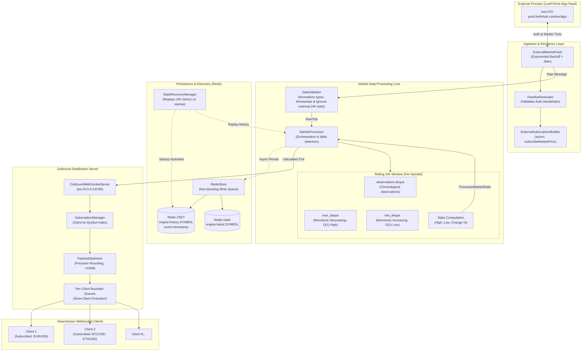
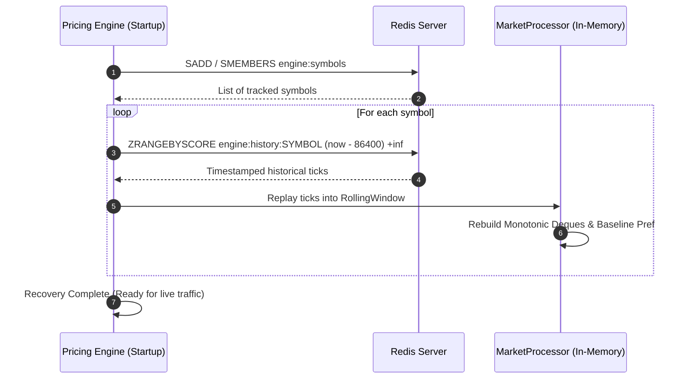
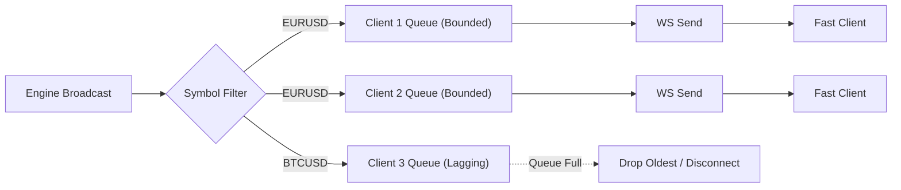

# Real-Time Pricing Engine: Architecture & Technical Design

## 1. System Overview

The **Real-Time Pricing Engine** is a high-throughput, low-latency market data processing system engineered in Python using `asyncio`, `websockets`, and `redis`. It ingests streaming market data from external algo feeds (`wss://v3-prod.livefxhub.com/ws/algo`), independently computes statistical rolling 24-hour metrics (High, Low, Percentage Change) using $O(1)$ monotonic deques, durably persists state in Redis, and distributes optimized updates (< 10 KB) to subscribed clients over an outbound WebSocket server.

---

## 2. High-Level Architecture Diagram

---

## 3. Mathematical Foundations & Algorithms

### 3.1 Consistent Price Basis
Market ticks contain separate `buy` and `sell` quotes. Calculating rolling statistics directly on raw bid or ask introduces spread-widening distortion (e.g. during liquidity lulls). To eliminate bias, the engine establishes the **Mid-Price** $P_{mid}$ as the invariant benchmark:

$$P_{mid} = \frac{P_{buy} + P_{sell}}{2}$$

The engine preserves exact `buy` and `sell` quotes as distinct fields, while High, Low, and Percentage Change are computed strictly over the continuous mid-price series.

### 3.2 Rolling 24-Hour Statistics ($O(1)$ Amortized)
Standard sliding window calculations that scan history take $O(N)$ time per tick, resulting in catastrophic latency spikes under high message volumes. The engine implements a dual **Monotonic Deque** architecture:

1. **Decreasing Monotonic Deque (`max_deque`)**:
   - Stores pairs $(t_i, P_{mid, i})$ where prices are kept in strictly decreasing order.
   - For an incoming tick $(t, P_{mid})$:
     $$\text{while } \text{max\_deque[-1]}.price \le P_{mid}: \text{max\_deque.pop()}$$
     $$\text{max\_deque.append}((t, P_{mid}))$$
   - The head of `max_deque` is always the global rolling maximum in $O(1)$.

2. **Increasing Monotonic Deque (`min_deque`)**:
   - Stores pairs $(t_i, P_{mid, i})$ in strictly ascending order.
   - For an incoming tick $(t, P_{mid})$:
     $$\text{while } \text{min\_deque[-1]}.price \ge P_{mid}: \text{min\_deque.pop()}$$
     $$\text{min\_deque.append}((t, P_{mid}))$$
   - The head of `min_deque` is always the global rolling minimum in $O(1)$.

3. **Window Expiration**:
   - Any observation with timestamp $t_i < T_{current} - 86,400\text{ seconds}$ is popped from `observations`.
   - When popped, expired items at the head of `max_deque` and `min_deque` are evicted in $O(1)$.

4. **Rolling 24-Hour Percentage Change**:
   - Let $P_{ref}$ be the earliest observation currently retained in the active rolling window ($t \ge T_{current} - 86,400\text{s}$).
   - If only one observation exists (e.g. cold start):
     $$\Delta\%_{24h} = 0.0$$
     *(The engine strictly never fabricates an imaginary reference price when none exists).*
   - If multiple observations exist:
     $$\Delta\%_{24h} = \left( \frac{P_{latest} - P_{ref}}{P_{ref}} \right) \times 100.0$$

---

## 4. State Persistence & Recovery Strategy

1. **Redis Data Structure**:
   - `engine:history:{SYMBOL}`: Redis Sorted Set (`ZSET`) where score is epoch timestamp ($t$) and member is compact JSON `{"t": t, "m": mid, "b": buy, "s": sell}`.
   - `engine:latest:{SYMBOL}`: Redis String/Hash caching the latest snapshot.
2. **Persistence Configuration**:
   - Redis is configured with `appendonly yes` and `appendfsync everysec` plus RDB snapshots (`save 900 1`).
   - Observations are pushed into an asynchronous queue, ensuring Redis I/O latency never blocks tick processing or WebSocket clients.
3. **Recovery Procedure**:
   - On process startup, `StateRecoveryManager` queries Redis for all recorded observations within the last 24 hours.
   - Observations are replayed into `RollingWindow.load_history()`, fully re-hydrating `max_deque`, `min_deque`, and $P_{ref}$ before opening socket listeners.

---

## 5. Outbound WebSocket Distribution & Slow-Client Isolation

- **Per-Client Bounded Queues**: Every client connection is isolated in its own `asyncio.Queue(maxsize=1000)`.
- **Non-Blocking Ingestion**: The broadcast method uses `put_nowait()`. If a client's network buffer is congested, the oldest tick is evicted, guaranteeing zero backpressure on the engine core.
- **Client Eviction**: If a slow client drops more than 50 consecutive messages, the connection is closed with WS code `1008 (Policy Violation)`.
